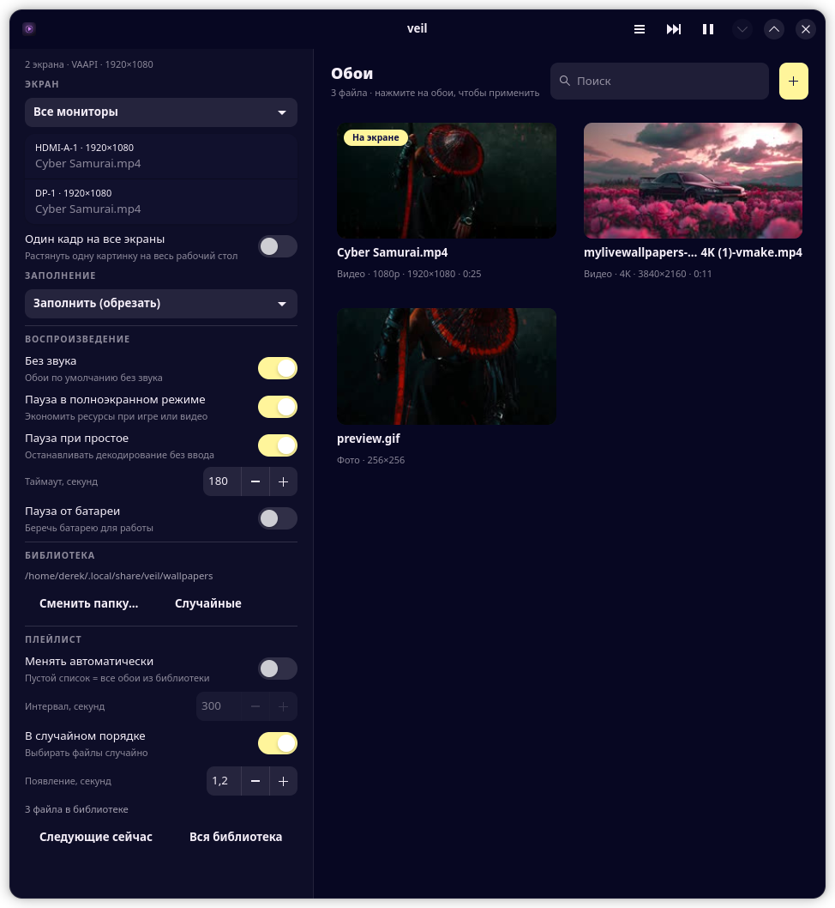

# veil

Видеообои для Wayland, которые не съедают процессор.

`veil` — это демон `veild`, клиент `veilctl` и графический выбор обоев `veil-gui`.
Демон рисует видео прямо в слой рабочего стола через EGL, декодируя его железом,
и останавливает воспроизведение, когда обои всё равно не видно.



## Зачем

Типичный `mpvpaper` запускает mpv с `hwdec=no`, то есть декодирует 4K60 в софте.
Замеры на этой машине (Ryzen 7 5700X + Radeon RX 580, два монитора 1080p,
одно и то же видео 3840×2160, 60 fps, 62 Мбит/с):

| | CPU | RSS |
|---|---|---|
| `mpvpaper` (hwdec=no) | **≈ 80 %** одного ядра | 690 МБ |
| `veild` (VAAPI, то же 4K-видео) | **≈ 9 %** | 356 МБ |
| `veild` со статичной картинкой | **0 %** | — |

Аппаратное декодирование того же клипа: 18.3 CPU-секунды против 0.2 — то есть
драйвер умеет, ему просто не давали.

## Как это работает

```
композитор ── wl_surface (layer-shell, слой background)
                    │
                    ├── EGL + wl_egl_window  (нет копий через shm)
                    │        │
                    │        └── libmpv render API ── VAAPI/VDPAU/NVDEC
                    │                                    │
                    └──────────── dmabuf ────────────────┘
```

* **libmpv render API** — mpv не открывает своё окно и не трогает композитор;
  он рисует кадр в наш OpenGL FBO. Мы отвечаем только за поверхность и время.
* **`hwdec=auto-safe`** — декодирование на GPU, кадр приходит в EGL как dmabuf,
  без чтения в системную память.
* **Один плеер на монитор**, каждый со своим EGL-контекстом: на разных частотах
  обновления кадры не мешают друг другу.
* **Правила паузы** — фуллскрин (`zwlr-foreign-toplevel-management`), простой
  (`ext-idle-notify`), работа от батареи, ручная пауза. В паузе декодер спит,
  а не крутит кадры «в никуда».
* **Один демон на сессию** — `flock` на `$XDG_RUNTIME_DIR/veil.lock`: если
  автозапуск сработал дважды (niri + systemd), второй процесс тихо выходит.
* **Ноль лишнего**: без звука, OSD, привязок клавиш, скриншотов и блокировки
  ввода — клики по обоям уходят дальше в композитор.

Перемотка, кодеки, цветокоррекция, HDR-тонмаппинг — всё это уже внутри mpv,
поэтому собственный велосипед не нужен.

## Выбор обоев (GUI)

`veil-gui` — обычное GTK4/libadwaita-приложение, поэтому выглядит родным и в
niri, и в KDE, и в GNOME:

* библиотека обоев сеткой с постерами, разрешением и длительностью;
* клик по обоям применяет их на выбранный экран («Все мониторы» или конкретный);
* панель мониторов: разрешение, текущий файл и отметка «свои» для экранов с
  собственными обоями, сброс в один клик;
* режимы `fill`, `fit`, `stretch`, `center` — применяются сразу;
* «Один кадр на все экраны» — одна картинка растягивается на весь рабочий стол,
  каждый монитор показывает свою часть без искажений;
* плейлист: автосмена с интервалом, случайный порядок, плавное появление,
  закрепление файлов правым кликом (пустой список = вся библиотека);
* перетаскивание видео и картинок прямо в окно — файлы копируются в библиотеку;
* папка библиотеки отслеживается: новые файлы появляются в сетке сами;
* «Добавить» копирует видео или картинку в библиотеку
  (`~/.local/share/veil/wallpapers`), правый клик — «Удалить из библиотеки»
  (файл уходит в корзину);
* переключатели «без звука», пауза в фуллскрине/при простое/от батареи и
  таймаут простоя;
* «Мастерская» — окно с каталогом обоев: поиск, превью, установка в один клик;
* случайные обои, поиск по библиотеке, статус демона и кнопка его запуска;
* всё, что меняется в окне, сразу пишется в `~/.config/veil/config.toml`.

Интерфейс на русском или английском — по `LANG`. Постеры для сетки делает
`ffmpeg` и кэширует в `~/.cache/veil/thumbs`; без ffmpeg GUI работает, но
показывает иконки вместо кадров.

## Плейлист и один кадр на все экраны

Плейлист живёт в конфиге и не зависит от GUI. По умолчанию он берёт все файлы
из библиотеки; `[playlist.outputs]` задаёт отдельные списки для конкретных
мониторов. Мониторы без своего списка меняют обои синхронно, со своим — живут
отдельно.

```toml
[playlist]
enabled = true
interval_secs = 300     # минимум 5
shuffle = true
fade_secs = 1.2         # появление из чёрного, 0 — выключить
items = []              # пусто = вся библиотека

[playlist.outputs]
"DP-1" = ["/home/user/Videos/left.mp4"]
```

Смена не переписывает конфиг: `wallpaper.path` остаётся тем, что выбрал
пользователь, а текущий файл идёт в `veilctl status` и в GUI.

Span (`wallpaper.span = true`) включает режим «один кадр на все экраны». Каждый
монитор по-прежнему декодирует своё, но mpv показывает нужный кусок общей
картинки: вычисляется общий bounding box мониторов, видео масштабируется под
него, а `video-zoom`/`video-pan-x`/`video-pan-y` сдвигают кадр на каждом экране.
Так 21:9-клип покрывает два 16:9-монитора без полос и растяжения. Индивидуальные
обои при этом игнорируются; выбор обоев для одного монитора выключает span.

## D-Bus

Демон поднимает `org.veil.Veild` на `/org/veil/Veil` (отдельное имя, потому что
`org.veil.Veil` занято самим GUI как GApplication id):

```sh
busctl --user call org.veil.Veild /org/veil/Veil org.veil.Veil Next
busctl --user call org.veil.Veild /org/veil/Veil org.veil.Veil Random
busctl --user call org.veil.Veild /org/veil/Veil org.veil.Veil Toggle
busctl --user get-property org.veil.Veild /org/veil/Veil org.veil.Veil PlaybackStatus
```

Методы: `Pause`, `Resume`, `Toggle`, `Next`, `Random`, `Status` (JSON).
Свойства: `PlaybackStatus` (`Playing`/`Paused`), `Version`. Если сессионной шины
нет, демон просто пишет предупреждение и работает дальше.

## Виджет Noctalia

В баре Noctalia достаточно CustomButton: левый клик — пауза, средний — следующее
обои, правый — окно выбора. В `~/.local/state/noctalia/settings.toml`:

```toml
[widget.veil]
type = "custom_button"
glyph = "movie"

[widget.veil.actions]
left = "exec veilctl toggle"
middle = "exec veilctl next"
right = "exec veil-gui"
```

После правки — `noctalia config validate && noctalia msg config-reload`.


## Мастерская (каталог обоев)

Своего Steam Workshop у veil нет и не нужно: каталог — это обычный JSON-файл на
любом статическом хостинге (raw.githubusercontent.com, GitLab Pages, свой
nginx). Один раз укажите ссылку, дальше обои ставятся из окна.

```sh
veilctl catalog --url https://example.com/catalog.json   # запомнить каталог
veilctl catalog cyberpunk                               # список и поиск
veilctl install neon-city                               # скачать и применить
veilctl install https://example.com/clip.mp4 --sha256 <hex>   # прямая ссылка
veilctl catalog                                         # весь каталог
```

Формат (пример — `docs/catalog.example.json`):

```json
{
  "version": 1,
  "entries": [
    {
      "id": "neon-city",
      "title": "Neon City",
      "author": "derek",
      "kind": "video",
      "description": "Ночной город под дождём, 4K",
      "tags": ["cyberpunk", "4k"],
      "preview": "https://example.com/neon-city.jpg",
      "url": "https://example.com/neon-city.mp4",
      "sha256": "0123…cdef",
      "size": 52428800,
      "license": "CC0"
    }
  ]
}
```

`id` — только `a-z`, цифры, `-`, `_`; `sha256` обязателен для записей каталога.
Загрузка идёт в `.<pid>.<имя>.part`, файл попадает в библиотеку только после
совпадения хеша, поэтому битая или подменённая загрузка не остаётся в папке.
Лимиты: 8 ГиБ на обои, 4 МиБ на манифест, 16 МиБ на превью; архивы не
распаковываются — только видео и картинки, так что zip-slip невозможен.
Превью кэшируются в `~/.cache/veil` и пережимаются тем же `ffmpeg`, что и
постеры библиотеки.

В GUI это кнопка с иконкой установки в шапке (`veil-gui --workshop`, меню «Мастерская обоев…» или `Ctrl+W`):
сетка карточек с превью, автором, тегами и размером, поиск по названию, автору
и тегам, кнопка «Установить» с индикацией уже установленного. Пустая ссылка —
окно само предложит её ввести.

## Wallpaper Engine

Сцены Wallpaper Engine (`scene`) — не видео: это `scene.json` и `.pkg` с
шейдерами, частицами и реакцией на курсор. Свой рантайм для них veil не
содержит; такие обои играет `linux-wallpaperengine` — отдельный процесс,
которому veil отдаёт нужные мониторы. Свои видео при этом рисует сам veil,
поэтому на одном экране может быть видео, а на другом — сцена WE.

Что работает: шейдеры и частицы, параллакс от курсора, аудио-реактивные сцены,
свойства обоев (`--list-properties`). Свои видео и картинки при этом остаются
на прежнем пути через mpv.

Установка движка и контента:

```sh
yay -S linux-wallpaperengine-git     # или paru -S ...
# Wallpaper Engine из Steam должен быть установлен: его папка assets нужна сценам
```

Дальше подпишитесь на обои в мастерской Steam (или откройте уже купленные):
файлы появятся в `steamapps/workshop/content/431960/<id>`, и veil увидит их сам.

```sh
veilctl engine status                  # бинарник, assets, сколько обоев, pid
veilctl engine list [query]            # что нашлось в мастерской
veilctl engine apply 1845706469        # на все мониторы
veilctl engine apply 1845706469 --output DP-1
veilctl engine props 1845706469        # настройки сцены: ключи, типы, значения
veilctl engine set 1845706469 clock off # выключить встроенные часы сцены
veilctl engine unset 1845706469 clock   # вернуть значение автора
veilctl widgets                        # виджеты: что настроено и запущено ли
```

В GUI обои из Steam стоят в общей сетке рядом с библиотекой, с подписью
`Wallpaper Engine · scene`; клик ставит их так же, как видео. Неподдерживаемые
типы (`web`, `application`) видны, но неактивны.

Как это устроено: `veilctl`/GUI передают демону путь-маркер `we:<id>`, демон
хранит его в конфиге (в `[outputs]` тоже), гасит свою поверхность на этих
экранах и держит один процесс `linux-wallpaperengine` с набором
`--screen-root <монитор> --bg <id>`. Если движок не установлен или упал, демон
пишет причину в лог и через 10 секунд пробует снова; остальные мониторы при
этом продолжают работать.

```toml
[engine]
binary = ""       # пусто — искать linux-wallpaperengine в PATH
assets = ""       # пусто — искать в библиотеках Steam
scaling = "fill"  # fill | fit | stretch — как движок вписывает картинку

[engine.properties]   # настройки сцены, уходят движку как --set-property
clock = "0"           # встроенные часы сцены выключены
audiobars = "0"       # без аудио-столбиков
# audiobarscolor = "255,136,0,255"   # цвет: R,G,B,A от 0 до 255
```

Свойства сцены — то, что автор объявил в `project.json`: часы, аудио-бары,
интенсивность частиц, цвет. `veilctl engine props <id>` показывает их списком
(ключ, тип, значение по умолчанию, варианты у списков), `set` и `unset` меняют
конфиг и перезапускают движок. Значения проверяются по типу: булевы принимают
`on/off/1/0`, цвета — `R,G,B,A` или `#rrggbb`, списки — номер или подпись,
ползунки — число в пределах `min…max`. Неизвестные ключи движок молча
игнорирует, поэтому настройки одной сцены не мешают другой.

В GUI на карточке обоев WE правый клик открывает «Настройки сцены…»: для
каждого свойства — переключатель, выпадающий список, ползунок или образец
цвета. Там же пункт меню «Настройки сцены…» (`Ctrl+Shift+S`) для той сцены,
что сейчас на экране. Изменения пишутся в конфиг и применяются сразу, с
перезапуском движка (сцена на секунду гаснет).

Правила паузы veil (`pause_on_battery`, простой, полный экран) на экраны с WE
не действуют: у движка свой цикл, veil его не останавливает.

## Виджеты

Часы, нагрузка, батарея, «сейчас играет» и просто текст — поверх обоев и под
окнами. Рисует их отдельный процесс `veil-widgets` (GTK4 + layer-shell): по
одному прозрачному окну на монитор, с пустой областью ввода, поэтому клики
уходят на обои и в окна, а виджеты никогда не забирают фокус.

Включаются в `~/.config/veil/config.toml`; проще всего — в GUI, кнопка
«Виджеты» в шапке (`Ctrl+Shift+W`):

```toml
[[widgets]]
kind = "clock"          # clock | stats | battery | mpris | text
output = "all"          # all | DP-1 | HDMI-A-1
x = 50                  # позиция в процентах от монитора, 0…100
y = 6
halign = "center"       # start | center | end — какая точка виджета в (x, y)
valign = "start"
size = 52               # кегль, pt
color = "#ffffff"
opacity = 0.9
shade = true            # плашка под текстом для читаемости на светлых кадрах
font = ""               # пусто — шрифт интерфейса
format = "%H:%M\n%d %B"
enabled = true
```

`format` зависит от типа:

| kind | что подставляется |
| --- | --- |
| `clock` | `%H` `%M` `%S` `%d` `%m` `%Y` `%A` `%B` `%%`, `\n` — перенос строки |
| `stats` | `{cpu}` процент, `{used}` и `{total}` ГБ, `{ram}` процент занятой памяти |
| `battery` | `{percent}`, `{state}` — «заряжается» / «от батареи» / «заряжено» |
| `mpris` | текст не нужен: берётся «исполнитель — название» из `playerctl` |
| `text` | строка как есть |

Позиции в процентах, а не в пикселях: один конфиг одинаково выглядит на 1080p
и на 4K. В редакторе виджеты перетаскиваются мышью по превью обоев; те же
проценты пишутся в конфиг, поэтому редактор и рендерер не расходятся.

```sh
veil-gui --widgets         # открыть редактор сразу, минуя главное окно
veilctl widgets            # что настроено и запущен ли рендерер
veil-widgets --check       # проверить конфиг, ничего не рисуя
veil-widgets               # запустить вручную (обычно это делает автозапуск)
```

Кнопки в редакторе: «+» — добавить виджет, переключатель в списке — включить
или выключить, поля справа — монитор, позиция, кегль, цвет, прозрачность,
плашка, шрифт и формат. Изменения сохраняются сразу, рендерер подхватывает
файл сам.

Чего нет: батареи на десктопе без `/sys/class/power_supply/BAT*` не будет
вовсе (виджет просто не показывается), а MPRIS-виджет требует `playerctl`.

## Совместимость

| Окружение | Статус | Как |
|---|---|---|
| niri | ✅ работает, тестировалось | `zwlr-layer-shell` |
| Hyprland | ✅ должно работать | `zwlr-layer-shell` |
| sway / другие wlroots | ✅ должно работать | `zwlr-layer-shell` |
| KDE Plasma 6 | ⚠️ плагин в `plugins/kde` (не тестировался в этой сессии) | KPackage-плагин обоев |
| GNOME | ❌ пока нет | нужен shell-extension, см. `plugins/README.md` |

Почему так: `wlr-layer-shell` — это протокол, по которому композитор отдаёт
клиенту «фон». niri, Hyprland и sway его реализуют. KWin и Mutter фон внешним
клиентам не отдают в принципе, поэтому там нужен плагин внутри оболочки.
`veil-gui` при этом остаётся просто настройкой демона: на Plasma обоями
управляет плагин, а не `veild`.

## Зависимости

* Rust ≥ 1.85 и `pkg-config`
* `libmpv` (в Arch — пакет `mpv`)
* Wayland, EGL, Mesa
* GTK4 + libadwaita (для `veil-gui`)
* `gtk4-layer-shell` (для `veil-widgets`)
* `ffmpeg`/`ffprobe` — для постеров и метаданных (необязательно)
* `playerctl` — для виджета «сейчас играет» (необязательно)

```sh
# Arch
sudo pacman -S rust mpv gtk4 libadwaita gtk4-layer-shell ffmpeg playerctl
```

## Сборка и установка

```sh
./install.sh
```

Скрипт собирает весь workspace, ставит `veild`, `veilctl`, `veil-gui` и
`veil-widgets` в `~/.local/bin`, desktop-файл и иконку в `~/.local/share`,
unit systemd и — если найден Plasma — плагин обоев.

Структура репозитория:

```
crates/core     библиотека veil: EGL, mpv, layer-shell, конфиг, IPC, span, D-Bus-клиент
crates/daemon   veild — фоновый демон и сервис org.veil.Veild
crates/ctl      veilctl — управление из терминала и скриптов
crates/gui      veil-gui — GTK4-выбор обоев и редактор виджетов
crates/widgets  veil-widgets — часы, нагрузка, батарея и MPRIS на layer-shell
crates/daemon (engine_host.rs) — процесс linux-wallpaperengine для сцен WE
packaging       desktop-файл, иконка, systemd unit, PKGBUILD
plugins         KDE-плагин и заметки про GNOME
.github         CI: fmt, тесты и release-сборка в контейнере Arch
```

Проверки:

```sh
cargo fmt --all -- --check
cargo test --workspace
```

Тесты покрывают разбор и round-trip конфига, serde-формат IPC, выбор файлов
плейлиста, разбор `project.json` и библиотек Steam, математику span (bounding box, zoom/pan для двух экранов,
панорамный исходник, вырожденные значения), виджеты (якоря, форматы времени,
шаблоны нагрузки и батареи, нормализацию цвета) и настройки сцен WE: разбор
`--list-properties`, типы значений, булевы/цвета/списки/ползунки в
`--set-property`. Для AUR есть
`packaging/PKGBUILD` (пакет `veil-git`).

## Использование

```sh
veil-gui                                # выбрать обои мышкой
veil-gui --scene 1845706469             # сразу настройки этой сцены
veilctl set ~/Videos/wallpaper.mp4      # поставить видео
veilctl set ~/Pictures/photo.png        # или картинку
veilctl set clip.mp4 --output DP-1      # только на один монитор
veilctl next [--output DP-1]            # следующее обои плейлиста
veilctl random [--output DP-1]          # случайное из плейлиста
veilctl clear [--output DP-1]           # снять индивидуальные обои
veilctl span on|off|toggle              # один кадр на все экраны
veilctl playlist on|off|toggle          # автосмена
veilctl catalog [query] [--url URL]     # каталог-мастерская
veilctl install <id|url> [--sha256 HEX] [--no-apply]
veilctl engine list|status              # обои Wallpaper Engine из Steam
veilctl engine apply <id> [--output DP-1]
veilctl engine props <id>               # свойства сцены
veilctl engine set <id> <key> <value>   # поменять свойство сцены
veilctl engine unset <id> [key]         # вернуть значения автора
veilctl status                          # мониторы, декодер, кадры, пауза
veilctl pause | resume | toggle
veilctl reload                          # перечитать конфиг
veilctl quit
```

`status` показывает главное для диагностики — какой декодер реально выбран:

```json
"outputs": [{ "name": "DP-1", "pixels": {"width":1920,"height":1080},
              "codec": "H.264 / AVC ...", "decoder": "vaapi", "frames": 2411 }]
```

Если `decoder` равен `no`, железо не подхватилось: проверьте `vainfo`
и поставьте в конфиге `hwdec = "vaapi"` (или `vaapi-copy` для проблемных драйверов).

## Конфигурация

`~/.config/veil/config.toml` создаётся при первом запуске:

```toml
[wallpaper]
path = "/home/user/.local/share/veil/wallpapers/wallpaper.mp4"
mode = "fill"          # fill | fit | stretch | center
color = "#000000"
span = false           # один кадр на все мониторы

[playback]
hwdec = "auto-safe"    # auto-safe | vaapi | vaapi-copy | vulkan | no
scale_filter = "lanczos"
fps_limit = 0          # 0 = как в видео; 30 экономит upload/композитинг
vsync = false          # true — ровнее на одном мониторе
flip_y = true          # GL-путь пишет кадр снизу вверх; false — если перевёрнуто
mute = true

[rules]
pause_on_fullscreen = true
pause_on_maximized = false
pause_on_idle = true
idle_timeout_secs = 120
pause_on_battery = false

[library]
path = "~/.local/share/veil/wallpapers"

[playlist]
enabled = false
interval_secs = 300
shuffle = true
fade_secs = 1.2
items = []

[playlist.outputs]
# "DP-1" = ["/home/user/Videos/left.mp4"]

[catalog]
# Манифест «мастерской»; пусто — окно предложит ввести ссылку
url = "https://example.com/catalog.json"

[engine]
# Сцены Wallpaper Engine играет linux-wallpaperengine, а не veil.
binary = ""       # пусто — искать в PATH
assets = ""       # пусто — искать в библиотеках Steam
scaling = "fill"

# Виджеты: рисует veil-widgets поверх обоев, под окнами.
[[widgets]]
kind = "clock"
x = 50            # проценты от монитора
y = 6
size = 52
format = "%H:%M\n%d %B"

[outputs]
"HDMI-A-1" = "/home/user/Videos/second.mp4"
```

`veilctl set` и `veilctl clear` сами сохраняют конфиг, поэтому их результат
переживает перезапуск демона. Автосмена, наоборот, ничего не пишет на диск.

Изменения применяются по `veilctl reload` или `kill -HUP $(pidof veild)`.
Монитор можно указать и в `veilctl set ... --output`. GUI пишет этот файл сам,
поэтому комментарии в нём не сохраняются — держите личные пометки вне конфига.

## Автозапуск

**niri** (`~/.config/niri/config.kdl`) — именно так настроено на этой машине:

```kdl
spawn-at-startup "/home/derek/.local/bin/veild"
spawn-at-startup "/home/derek/.local/bin/veil-widgets"
```

Вторая строка нужна только если в конфиге есть `[[widgets]]`; без виджетов
процесс сразу выходит. Путь лучше писать абсолютным: на старте сессии
`~/.local/bin` может ещё не быть в `PATH`.

**systemd** (если в user-сессии проброшены `WAYLAND_DISPLAY` и `XDG_RUNTIME_DIR`,
как это делает uwsm):

```sh
systemctl --user daemon-reload
systemctl --user enable --now veil.service
```

Можно включить оба способа: `flock` не даст запуститься второй копии.

Не запускайте одновременно другой видео-демон: оба слоя будут декодировать
видео, даже если виден только верхний. В Noctalia обои выключены
(`wallpaper.enabled = false`), иначе она продолжит запускать свой `mpvpaper`.

## Если что-то не так

* **Чёрный экран** — `veilctl status`: есть ли `outputs`, `configured: true`.
  Демон пишет в stderr, запустите `veild -v` из терминала.
* **GUI не видит демон** — проверьте `$XDG_RUNTIME_DIR/veil.sock` и запустите
  `veild`; кнопка «Запустить демон» в окне делает то же самое.
* **Картинка перевёрнута** — поставьте `flip_y = false` (по умолчанию `true`,
  потому что GL-кадр приходит снизу вверх) и сделайте `veilctl reload`.
* **Дёргается на двух мониторах** — оставьте `vsync = false`.
* **Высокий CPU** — посмотрите `decoder` в `status`. Если `no`, включите
  VAAPI явно и проверьте `vainfo`. Если `vaapi`, но всё равно много — уменьшите
  разрешение исходника: 4K на 1080p-экране декодируется вчетверо дороже нужного.

## Дорожная карта

* дробное масштабирование (`wp_fractional_scale` + viewporter)
* расширение GNOME Shell
* тонкая настройка пауз (по приложению, по видеозвонкам)
* полноценный кроссфейд между двумя mpv-плеерами

## Лицензия

MIT.
